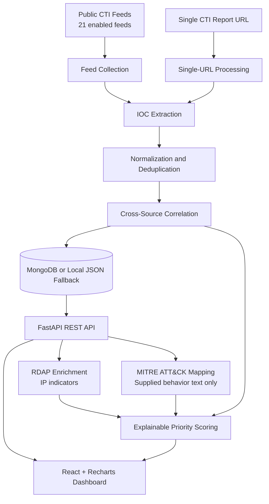

# System Architecture

The following diagram shows the main data flow through the Cyber Threat Intelligence Correlation System.

## Important Notes

- Priority scoring is a project-defined heuristic for analyst triage, not proof that an indicator is malicious.
- MITRE ATT&CK mapping uses supplied behavioral text; an IOC is not automatically attributed to a technique merely because it exists.
- MongoDB is supported, with local JSON storage as a fallback.
